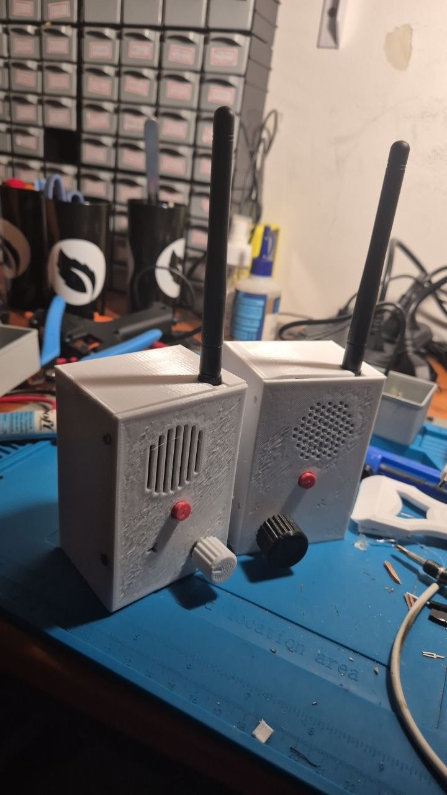
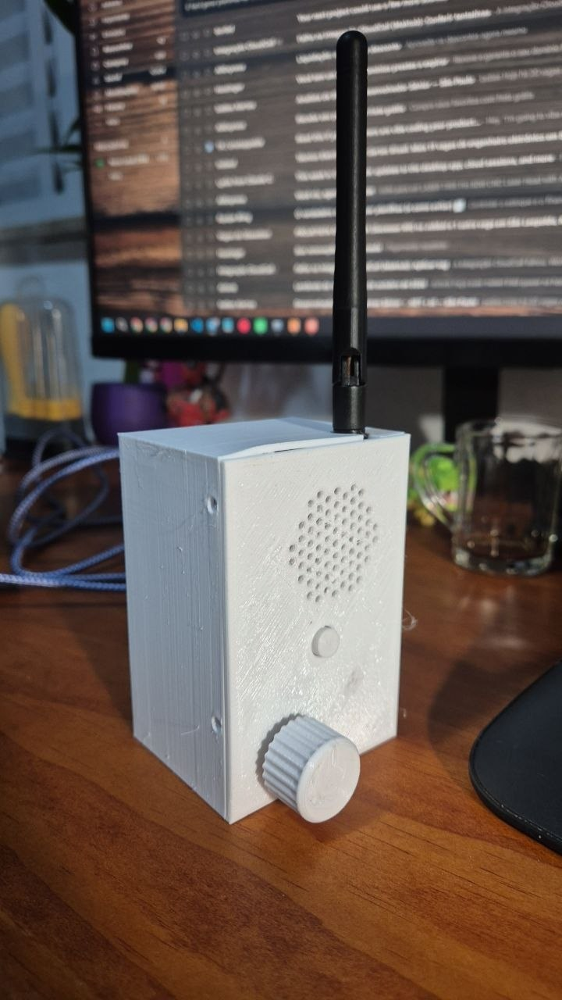
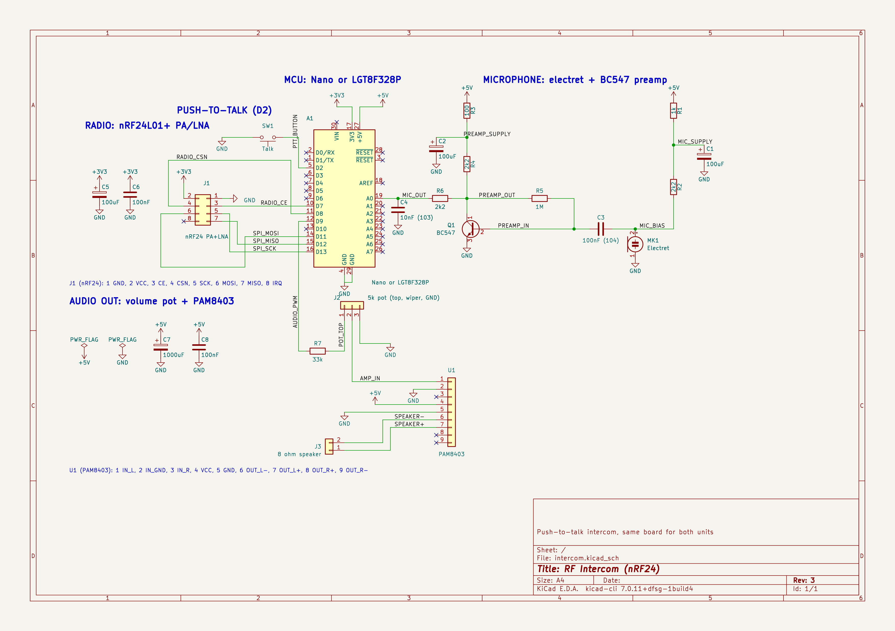
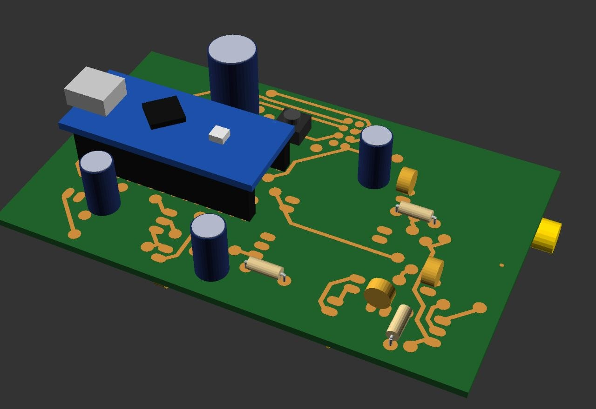
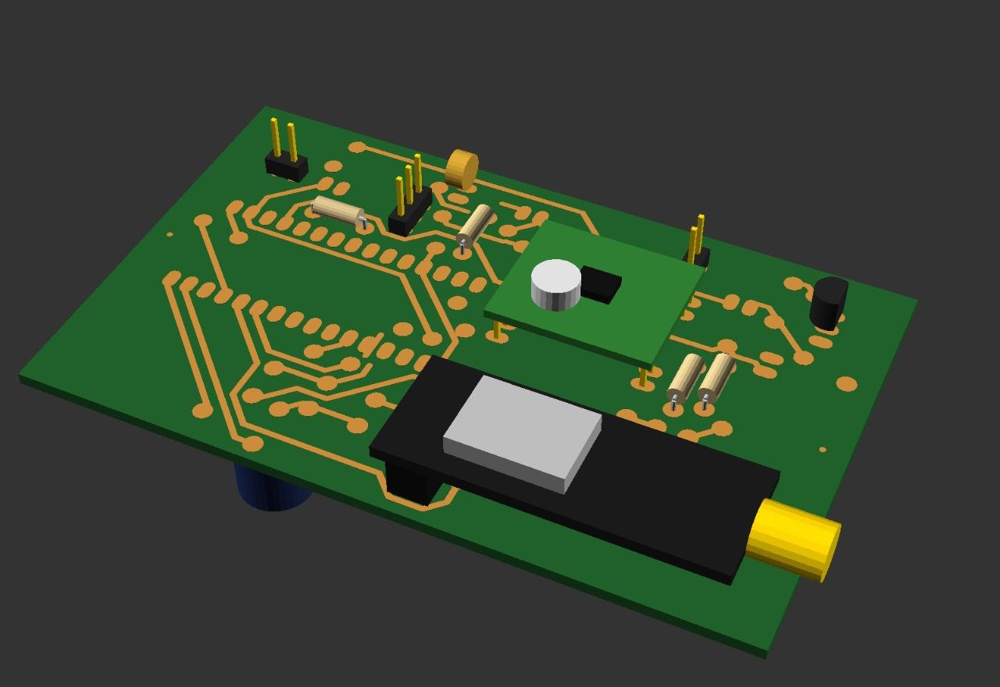
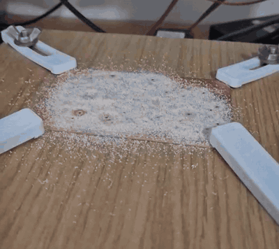
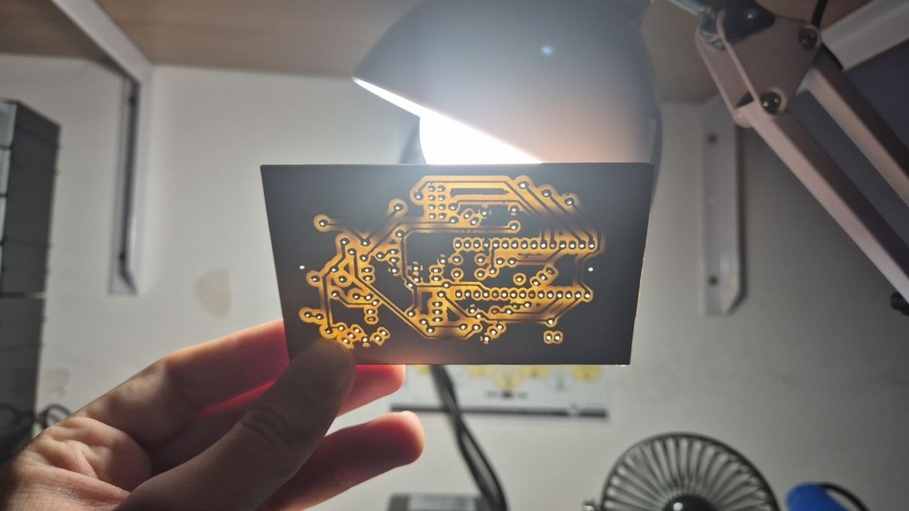
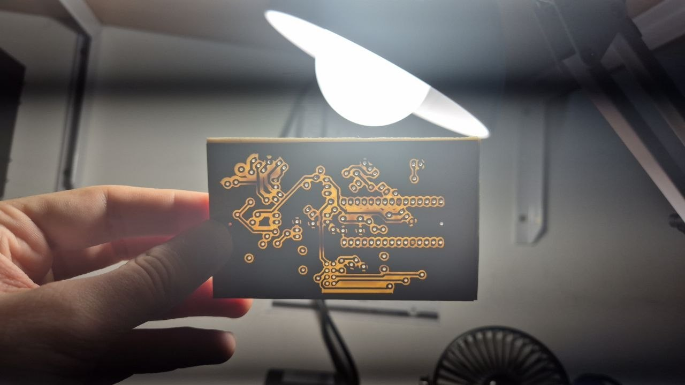
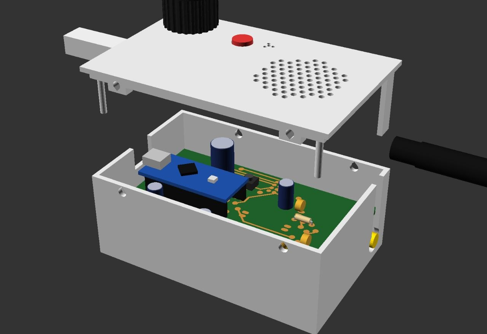
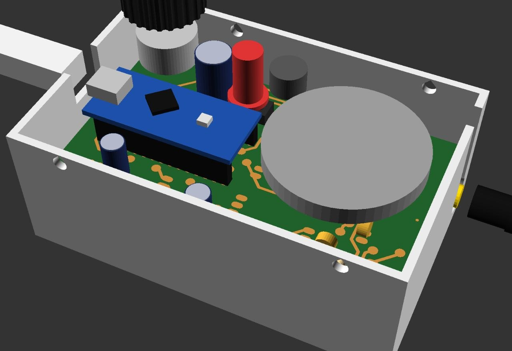

# RF Intercom

Interfone de apertar para falar, **sem fio**: as duas unidades conversam por rádio (nRF24L01+ com antena) e só precisam de uma tomada. Na prática é um walkie talkie de mesa, ligado na energia em vez de bateria, e por isso o nome interfone.

Projeto completo feito em casa: circuito, placa de circuito impresso fresada numa CNC caseira, firmware de áudio digital e caixa impressa em 3D.

<p align="center">
  
  
</p>

**As duas unidades conversando** (com som):

https://github.com/user-attachments/assets/871d9580-77c3-4d14-9feb-cfa74ef9aef5

## Como funciona

1. Ao apertar o botão, a unidade toca um bipe curto e passa a transmitir.
2. O microfone de eletreto passa por um pré-amplificador com um transistor BC547 e chega na entrada analógica do Arduino.
3. O Arduino amostra a voz a 8 kHz, com 8 bits, junta 32 amostras em cada pacote e envia pelo nRF24 a 250 kbps.
4. A outra unidade guarda os pacotes numa fila circular e os toca no ritmo certo, por interrupção de timer, gerando o áudio por PWM.
5. O sinal passa pelo potenciômetro de volume e pelo amplificador PAM8403 até o alto-falante.

Ao soltar o botão, a unidade volta a escutar. O mesmo firmware roda nas duas unidades.

## Hardware

| Bloco | Componentes |
|---|---|
| MCU | Arduino Nano ou LGT8F328P (mesma pinagem) |
| Rádio | Módulo nRF24L01+ PA/LNA com antena SMA, desacoplado com 100 µF + 100 nF |
| Microfone | Cápsula de eletreto + pré-amplificador com BC547, alimentação filtrada por RC |
| Saída de áudio | PWM no D9, resistor de 33k, potenciômetro de 5k e módulo PAM8403 |
| Alto-falante | 8 Ω, 40 mm |
| Alimentação | 5 V pelo USB do Arduino; 3,3 V do próprio Arduino para o rádio |



O esquemático e a placa estão em [`hardware/`](hardware/) (KiCad).

## Placa

A placa tem 85 × 52 mm, face simples, com solda só no lado de baixo. Ela foi pensada desde o início para ser fresada em casa: ilhas grandes, trilhas de 1 mm, isolação de 0,5 mm, áreas livres nos cantos para as garras e dois fiduciais para alinhar a placa virada.

O **posicionamento e o roteamento** foram feitos por um plugin de KiCad que eu desenvolvi para posicionamento e roteamento automáticos. A fabricação usou os meus plugins para a fresa, que geram o G-code direto do KiCad, com voos de teste antes de cortar e medição da altura da placa:

- Plugin de posicionamento e roteamento para KiCad: [kicad-cnc-router](https://github.com/aluisioalves123/kicad-cnc-router)
- Plugins da fresa (exportação do KiCad e Candle): [fresa-pcb](https://github.com/aluisioalves123/fresa-pcb)

Os arquivos de fabricação estão em [`hardware/fabrication/`](hardware/fabrication/): gerbers, G-code das três fases (cobre de cima, furação, cobre de baixo) e o passo a passo de montagem com uma imagem por etapa.

<p align="center">
  
  
</p>

Saindo da fresa, debaixo do pó de fenolite:

<p align="center">
  
</p>

Placa fresada, vista contra a luz:

<p align="center">
  
  
</p>

## Firmware

Em [`firmware/`](firmware/), para a Arduino IDE com a biblioteca [RF24](https://github.com/nRF24/RF24):

| Sketch | Para que serve |
|---|---|
| `intercom` | Firmware das duas unidades |
| `intercom_debug` | Igual ao `intercom`, mais um contador de pacotes por segundo no Monitor Serial (usado para diagnosticar o rádio) |
| `mic_test` | Mostra o sinal do microfone no Plotter Serial, para testar o pré-amplificador |

Pontos principais:

- **Áudio a 8 kHz:** a captura é cronometrada por `micros()`, e a reprodução usa uma interrupção do Timer2 a 8 kHz.
- **Fila circular de 256 amostras**, com índices de 8 bits que dão a volta sozinhos. A reprodução só começa com 96 amostras guardadas, para absorver a irregularidade do rádio.
- **PWM rápido de 8 bits no Timer1** para o áudio. Quando não está tocando, o pino fica solto, para não gerar chiado.
- **Remoção do nível DC do microfone** por média móvel, com ganho ajustável.
- **Rádio sem confirmação de recebimento:** em áudio ao vivo, reenviar um pacote atrasado é pior do que perdê-lo.
- **Funciona nos dois microcontroladores:** o Timer2 se ajusta ao clock (16 MHz no Nano, 32 MHz no LGT).

## Caixa

Em [`mechanical/`](mechanical/): modelada em OpenSCAD a partir das medidas reais da placa montada e impressa em PETG.

- A placa fica virada dentro da caixa, com o rádio, o botão e o amplificador voltados para a tampa.
- Saída retangular para o USB e rasgo para a antena, fechado por uma lingueta da tampa.
- Alto-falante preso por três presilhas de encaixe. Knob próprio para o potenciômetro.
- Tampa presa por parafusos M3 autoatarraxantes, deitados nas paredes compridas.

Os STLs prontos estão em [`mechanical/stl/`](mechanical/stl/), e o [`assembly.scad`](mechanical/assembly.scad) mostra a placa dentro da caixa.

<p align="center">
  
  
</p>

As imagens do modelo são de uma versão anterior da caixa: grade do alto-falante com furos redondos e pinos compridos na tampa, que foram retirados. A versão atual usa rasgos na grade, como na unidade da esquerda na foto do topo.

## O que deu errado e como foi resolvido

**Mau contato na própria protoboard.** Um bloco falhava, mas o componente funcionava em outro lugar da protoboard, então o problema não era ele. Embaixo da protoboard havia protuberâncias no plástico. Abrindo, as barras metálicas estavam quase saindo dos encaixes. Recoloquei as barras e reforcei com fita isolante, e a partir daí o nRF24 passou a funcionar.

**PAM8403 oscilando.** A alimentação do amplificador era compartilhada com os outros módulos da montagem. Um fio dedicado, direto da alimentação do Arduino até o PAM8403, sem passar por outros componentes, resolveu.

**Ruído da alimentação USB.** Ligado no USB de um computador, aparece um ruído no áudio. Filtros RC em vários pontos do circuito (inclusive nas alimentações do microfone e do pré-amplificador) reduziram bastante, mas não eliminaram. Num carregador de tomada ou numa fonte de bancada, ele desaparece.

**Curto entre 5 V e GND na placa fresada.** A placa media 0,8 Ω entre 5 V e GND, e a primeira ligação queimou o diodo de proteção do USB do Nano. Para achar o curto, injetei 0,5 V com limite de corrente na rede de 5 V e medi a queda de tensão, em milivolts, em vários pontos da rede: o ponto com a menor leitura é o mais perto do curto. Foram duas causas: uma bolinha de solda encostando no plano de GND e "dentes" deixados por uma fresa gasta perto do capacitor C7. O Nano e o LGT voltaram a funcionar com um jumper no lugar do diodo queimado.

**Furos da tampa desalinhados.** A tampa é impressa de cabeça para baixo e virada na montagem, e virar espelha a frente com o fundo. O modelo não compensava isso, então os furos ficavam 2 mm fora e a lingueta da antena caía do lado errado. O arquivo de impressão passou a sair espelhado.

**Primeira camada do PETG.** Os furinhos redondos da grade do alto-falante soltavam da mesa na primeira camada. A grade virou rasgos compridos, e o furo do microfone virou uma estrela de três braços, num furo só.

**Potenciômetro queimado na montagem.** Soldar fios direto nas pernas do potenciômetro, feitas para ir espetadas numa placa, estragou o contato interno do cursor. O volume caía quase a zero.

## O que eu aprendi

**Validar em pequenos degraus.** A vontade de ver tudo funcionando é grande, e a tentação é montar tudo e testar só no final. Quando dá errado assim, fica difícil saber o que funcionou e o que não funcionou. O que salvou este projeto foi separar as partes: testar o nRF24 sozinho, depois o resto do circuito sozinho, e só então os dois juntos, até dar certo. O mesmo valeu para o áudio: o sistema de som foi testado sem nada do rádio, os microfones foram testados isoladamente, e assim por diante. Isso deixou claro o problema de cada parte, e juntando aos poucos deu para perceber como uma interferia na outra.

**Dois nRF24 muito próximos se atrapalham.** Com as unidades lado a lado e o amplificador do rádio em potência alta, a comunicação falha. Em potência baixa funciona perto e ainda alcança outros cômodos.

**O plano de GND faz muita diferença.** Na perfboard eu tinha muita dificuldade de conseguir um sinal de voz bom. Na placa de cobre fresada, com o plano de GND, a qualidade melhorou muito, mesmo com o ruído da alimentação USB.

**Capacitores de desacoplamento são essenciais**, tanto para a qualidade do sinal quanto para a estabilidade do circuito como um todo.

**Filtros RC no áudio.** Eu nunca tinha trabalhado com microfone. Aprender a filtrar a alimentação do eletreto e do pré-amplificador foi uma parte importante do projeto.

**Fresa e impressão 3D.** As duas eram novidade para mim, e boa parte do aprendizado veio delas: fabricar a placa em casa e desenhar a caixa a partir das medidas reais.

### Próximos passos


A melhoria mais imediata seria uma **bateria própria**. Além de tornar o interfone portátil, ela eliminaria de vez o ruído da alimentação USB.

## Estrutura do repositório

```
rf-intercom/
├── hardware/          projeto KiCad (esquemático, placa, biblioteca)
│   └── fabrication/   gerbers, G-code e passo a passo de montagem
├── firmware/          sketches do Arduino
├── mechanical/        caixa e knob em OpenSCAD, e os STLs
└── docs/              esquemático exportado e fotos
```
